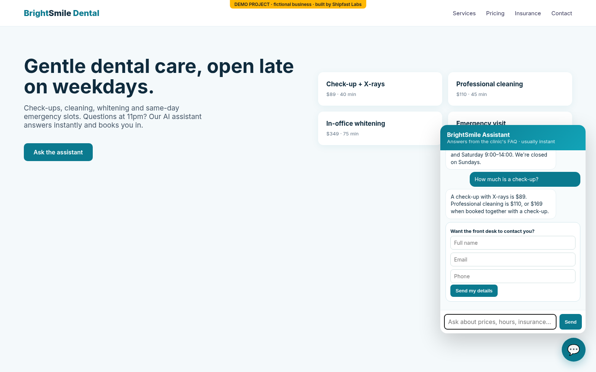
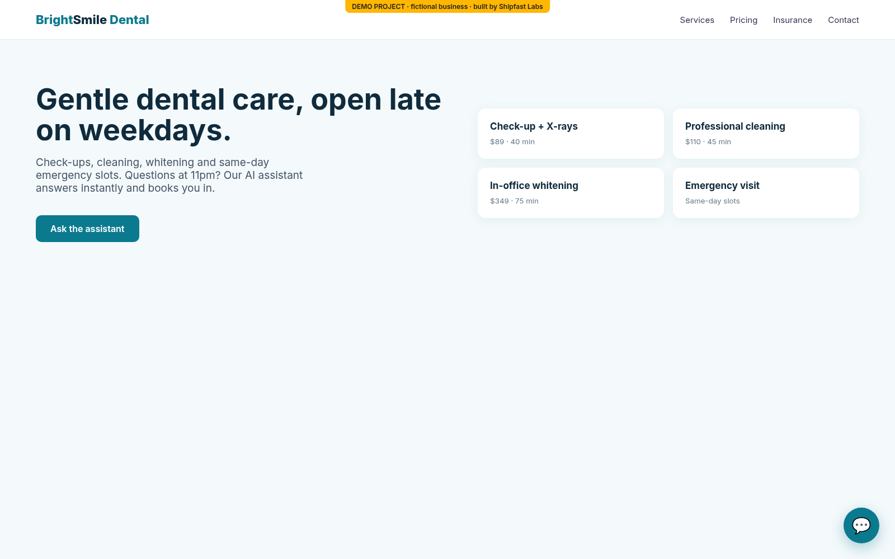
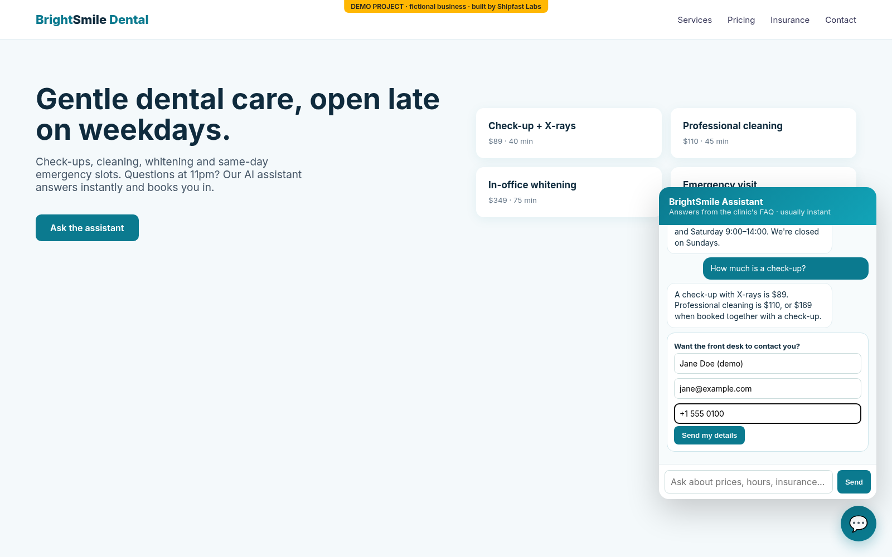
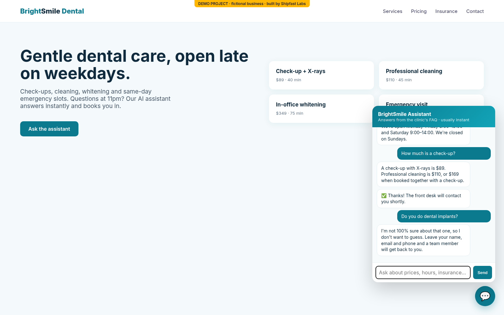

# AI Website Assistant + Lead Capture

> **Sample project** for a fictional business ("BrightSmile Dental"). Built by Viktor / Shipfast Labs to show the $500, 3-day *Website AI Assistant* package. No real client, no real data.



## Challenge
Small clinics and local businesses get questions after hours (prices, hours, insurance, emergencies). Nobody answers, and the visitor leaves.

## Solution
- Drop-in chat widget (plain HTML/JS, no framework) that can sit on any existing site.
- Answers **only from the business's own FAQ** (`data/faq.json`), so it doesn't make things up.
- If it doesn't know, it says so and **hands off to a human** instead of guessing.
- Captures **name, email, phone** + the questions asked, saved to `data/leads.csv` (open in Google Sheets via File → Import). Download at `/api/leads.csv`.
- **LLM mode:** set `OPENAI_API_KEY` and answers are generated by the model, constrained to the FAQ context. **No key?** A deterministic keyword-retrieval fallback answers from the same FAQ, so the demo always runs.

## What it does (capabilities)
| | |
|---|---|
| Grounded answers | FAQ-only context, refuses to invent |
| Lead capture | Validated name/email/phone → CSV / Sheets-ready |
| Human handoff | Unknown question → lead form |
| Static mode | `public/` works on GitHub Pages: answers from `faq.json`, leads kept in localStorage |

## Run it
```bash
python3 server.py            # http://localhost:8081  (Python 3.9+, no dependencies)
OPENAI_API_KEY=sk-... python3 server.py   # optional real LLM answers
```
Static demo only: serve or publish the `public/` folder (e.g. GitHub Pages).

## Customise for a business
Edit `data/faq.json` (questions, keywords, answers) and the brand colours in `public/index.html`. In production the `print("NEW LEAD")` line becomes an email / Slack / Google Sheets webhook.

## Screenshots
| Landing | Lead form | Saved + handoff |
|---|---|---|
|  |  |  |

## Stack
Python stdlib HTTP server · vanilla JS · OpenAI Chat Completions API (optional) · CSV / Google Sheets
